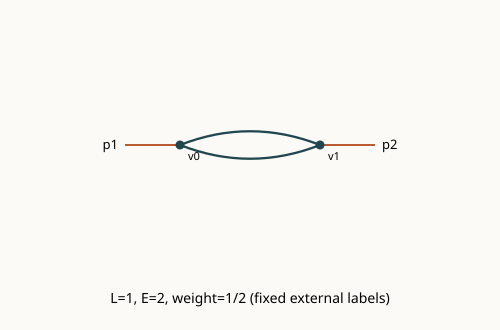
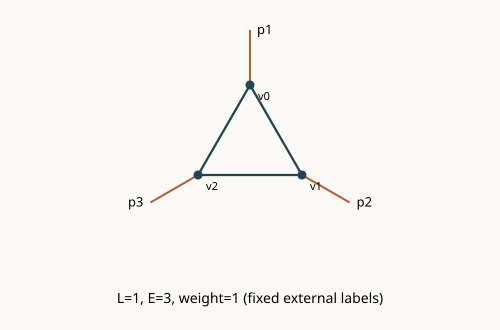

# φ³ Renormalization

Computational tools associated with the MPhys Theoretical Physics project
*Renormalization in phi-cubed theory*, University of Edinburgh.

**This is a deliberately bounded initial public release.** The active research
software continues to develop separately. This repository publishes a reviewed
bare-graph kernel from the existing implementation and original reproducible
examples. It is not a replacement for the full research workbench or a complete
renormalization engine.

## Scientific background and implemented scope

For connected trivalent scalar graphs, `3V = 2I + E` and `L = I - V + 1`.
With propagator UV scaling `k^-2`, superficial power counting gives
`ω = dL - 2I`, reducing to `ω = 6 - 2E` in six dimensions.

Implemented capabilities include an exact multigraph representation, parallel
edges and self-loops, fixed labelled external half-edges, connectivity/1PI tests,
small-graph canonicalization, rational combinatorial weights, bounded enumeration,
and edge-set divergent-subgraph identification. Henge and disjoint contraction
helpers are retained as experimental kernel functions; they do not implement BPH
recursion or a forest formula.

Enumeration is limited to one/two loops, one/ two/three external legs and at most
five vertices. The public demo shows a one-loop two-point bubble and three-point
triangle. It also checks the seven two-loop three-point topologies in its declared
fixed-label convention. A count in this convention does not settle counts under
source attachments or different labelling rules.




## Installation, quick start and reproducibility

Python 3.11 or newer; no runtime dependencies.

```bash
python -m venv .venv
# Activate the environment using your platform's normal command.
python -m pip install ".[dev]"
phi3-demo --output runs/demo
python -m pytest -q
```

`runs/demo/graphs.json` contains graph data, Euler/trivalence identities,
combinatorial weights, d=6 power counting and the explicitly bounded catalogue
count. SVGs are generated from the graph edges, rather than hand-drawn figures.
Use a new directory for each run.

An explicit JSON graph can also be inspected:

```bash
phi3-demo --input examples/bubble.json --output runs/bubble
```

[Conventions](docs/conventions.md) define interaction normalization, external
momenta, graph counting, symmetry weights and the future subtraction boundary.
[Source provenance](docs/source-provenance.json) identifies the retained component
without disclosing machine paths or private research documents.

## Verification and scientific limits

Tests check known bubble/triangle factors, all six supported loop/leg classes,
Euler/trivalence identities, vertex relabelling invariance, proper subgraph
boundary ports and invalid discrete inputs. Validation covers the finite declared
scope. It is not a proof of a general all-loop enumeration or convergence theorem.
See [observed validation](docs/validation.md).

```bash
python -m ruff check src tests
python -m ruff format --check src tests
python -m build
```

Numerical amplitudes, local counterterm integrals, full BPH subtraction, insertion
amplitudes, higher-loop closure and uniform convergence estimates are **not
implemented in this public subset**. Their absence here does not describe the
current status of the separately developing research program.

The full Windows implementation will be considered for a later audited import,
with stable graph identities and a versioned migration record. Private supervisor
correspondence, meeting notes, operational jobs and restricted research materials
are excluded. [Publication scope](docs/publication.md).

## Roadmap and references

[Prioritized roadmap](ROADMAP.md) separates software milestones from mathematical
research questions. Fixed-momentum finiteness alone does not establish the
uniform subgraph-momentum estimates needed in a recursive convergence proof.

References: Mark Srednicki, *Quantum Field Theory*, dimensional analysis and
renormalization sections ([author's page and errata](https://www.physics.ucsb.edu/~mark/qft.html));
A. D. Kennedy, *A Simple Proof of the BPH Theorem*,
[hep-th/9612113](https://arxiv.org/abs/hep-th/9612113).
Zimmermann's forest formula is an established representation; this repository
does not claim to reprove it or equate different subtraction schemes.

MIT licensed original software; external books and papers are cited, not bundled.
