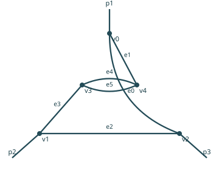

# L2E3G4: a two-point subdivergence, term by term

[中文](L2E3G4-zh.md) · [Exact source records](../examples/counterterms/L2E3G4.json)



The stable identity is `g_d51e19439eb235ebf83d`. Edges 4 and 5 are the parallel
edges of the bubble. In the recorded basis `(q1,q2,p1,p2)`, their momenta are
`q1−q2` and `q2`. The two boundary ports carry `−q1` and `+q1`; hence the
subgraph external momentum is `P=±q1`, with `q2` the inner loop. Outside edges
0,1,2,3 carry `q1+p1, −q1, −q1+p2, q1` and remain present.

Let `D(k)=1/(k²+m²)`. With a common regulator, the bubble's degree-two Taylor
projection, after odd terms integrate to zero and rotational tensor reduction,
is `K_m + P² K_z`, where

$$K_m=\int_q D(q)^2,\qquad
K_z=\int_q\left[-D(q)^3+\frac{4}{6}q^2D(q)^4\right].$$

Before integration the odd term is `−2(q·P)D(q)^3`, and the quadratic terms are
`−P²D(q)^3+4(q·P)²D(q)^4`. The `4/6` follows from
`∫q_μq_ν f(q²)=δ_μν∫q²f(q²)/6`. This requires the stated rotationally invariant
common regulator. `K_m,K_z` remain regulated symbolic integrals here; the
combinatorial plus sign below does not assert that `K_z` is positive.

## The two independent coefficient routes

The bubble's positive weight is `1/2`. Thus its action coefficients are
`δm²=g² K_m/2` and `δZ=g² K_z/2`; the inserted vertices are their negatives.
The host has three ordinary cubic vertices, giving `(-g)^3=−g³`.

| Term, after factoring out g⁵ | Path A: bare recursive subtraction | Path B: action-generated insertion |
|---|---:|---:|
| Bare original graph `I_G` | `−1/2` | `−1/2` |
| Mass kernel `K_m H_m` | `(−1/2) × (−1) = +1/2` | host `1` × source `1/2` × ports `2/2!` × signs `(−1)(−1) = +1/2` |
| Kinetic kernel `K_z H_z` | `(−1/2) × (−1) = +1/2` | the same exact factor `+1/2`, with a separate `P²` operator |

Here `H_m=∫_{q1}D(q1+p1)D(q1)^2D(q1−p2)` and `H_z` has the additional
factor `q1²`. The squared propagator is retained because the local two-valent
vertex splits the original host line. The two port bijections are divided by
`2!`; adding an extra factor of two would be a mistake.

Both paths therefore give

$$\bar\Gamma_G=g^5\left[-\frac12 I_G+\frac12 K_mH_m+\frac12 K_zH_z\right],
\qquad\Gamma_{R,G}=(1-T^0_{p_1,p_2})\bar\Gamma_G.$$

The overall local column has the opposite coefficient for each projected term:
`+1/2` for `T⁰ I_G`, `−1/2` for `K_m T⁰H_m` and `−1/2` for `K_z T⁰H_z`.
Even at physical `p1=p2=0`, the loop variable `q1` is integrated, not set to zero;
the kinetic insertion remains. Scaling host propagators during the bubble's
Taylor operation would change the subtraction scheme.

## Reproduce and inspect

```bash
phi3-ct build --output runs/L2E3G4-demo
phi3-ct verify --input runs/L2E3G4-demo
phi3-ct serve --input runs/L2E3G4-demo --language en
```

Select the L2E3G4 row. The JSON records retain the source/host weights, boundary
ports, compatible routing, edge maps, both actual generation paths and all
eleven cells. The complete family has 77 exact cells; this example adds no
numerical integral acceptance.
